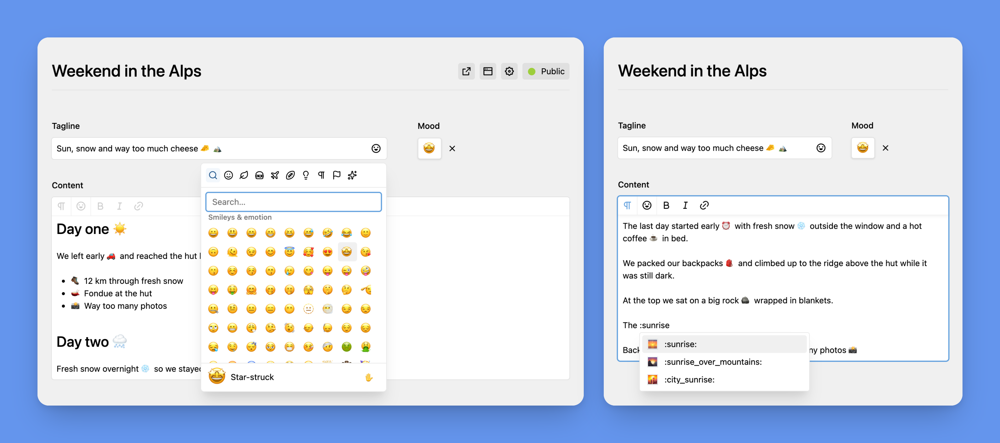

# 😄 Kirby Emojis

A Kirby 6 plugin that adds an emoji picker to the Panel: emoji fields, a Writer node, a Textarea button,
shortcode suggestions and, with **Pro**, custom emoji uploads. Emojis are **stored as Unicode** and can be
shown as native characters or, with **Pro**, as **Noto, Fluent or OpenMoji images**, in the Panel and on
the front end.

> Status: in development, built against Kirby 6.0.0-beta.3.



## Features

- 😀 **Emoji field**: pick a single emoji
- ✍️ **Emoji Text field**: the text field with an emoji picker that inserts at the cursor
- 📝 **Writer**: an `emoji` node with a toolbar button and custom emojis
- 🔤 **Textarea**: an `emoji` toolbar button
- 🔍 **Shortcode suggestions**: type `:rock` in Emoji Text, Writer and Textarea fields
- 🎨 **Emoji sets** (Pro): Noto, Fluent, OpenMoji or your own, served from your server
- 🦜 **Custom emojis** (Pro): upload your own images and use them as `:party-parrot:`
- 🧩 **Field methods**: `->emojis()`, `->toEmoji()`, `->toEmojiText()`
- 🌍 **Translated**: Panel in `en`, `de`, `es` and `fr`, emoji names in the editor's language

Features marked **(Pro)** need a license, see [Editions](#editions).

The picker is built on [vue-frimousse](https://vue-frimousse.robertshaw.me) and uses
[Emojibase](https://emojibase.dev) data, with category tabs, search, skin tones and recently used emojis.

## Installation

```bash
composer require jeslage/kirby-emojis
```

Or download the repository into `site/plugins/kirby-emojis`. The built Panel assets (`index.js`,
`index.css`) are part of the repository.

## Fields

```yaml
fields:
  mood:
    type: emoji
  status:
    type: emojitext
    placeholder: What's up?
    maxlength: 80
```

- **`emoji`**: a single emoji, stored as a string (`:shortcode:` for custom emojis).
- **`emojitext`**: the core text field (placeholder, `maxlength`, `before`, `after`, `counter`, …) with
  a picker button. Custom emojis and set images are shown as images while typing.

Both fields take these options. **Empty options fall back to the [site-wide settings](#settings)**:

| Option             | Default | Description                                                              |
| ------------------ | ------- | ------------------------------------------------------------------------ |
| `categories`       | all     | Categories in the picker, e.g. `[smileys-people, animals-nature]`         |
| `skinTone`         | `none`  | `none`, `light`, `medium-light`, `medium`, `medium-dark` or `dark`        |
| `skinToneSelector` | `true`  | Show the skin tone selector                                               |
| `customEmojis`     | `true`  | Show custom emojis (Pro)                                                  |

Categories: `smileys-people`, `animals-nature`, `food-drink`, `travel-places`, `activities`, `objects`,
`symbols`, `flags`.

### Writer

Add the `emoji` node. It adds the toolbar button (inline nodes appear with the marks), custom emojis and
suggestions:

```yaml
text:
  type: writer
  nodes: [heading, bulletList, orderedList, emoji]
```

Custom emojis are stored as `<span data-emoji="party-parrot" class="k-emoji">:party-parrot:</span>`
(the Writer doesn't allow ``). Use `->emojis()` to show them as images.

### Textarea

Add `emoji` to the toolbar buttons. Fields with the button also get shortcode suggestions:

```yaml
text:
  type: textarea
  buttons: [headlines, bold, italic, "|", link, email, "|", emoji]
```

## Settings

**Panel → Emojis** has the site-wide settings (stored in `site/config/emojis.yml`):

- **General**: emoji set (Pro), picker categories, default skin tone, skin tone selector, shortcode
  suggestions, recently used emojis, custom emojis (Pro)
- **Custom Emojis** (Pro): upload and manage custom emojis
- **Image Cache** (Pro): fill or clear the cached set images

Precedence: field blueprint > Emojis view > config options. Users need the `jeslage.emojis.settings`
permission to change the settings (on by default; turn it off per role in its blueprint).

## Emoji sets (Pro)

The set chosen in Panel → Emojis is used in the Panel and by `->emojis()`. Images are fetched once from
the set's CDN and stored in `media/emojis/{set}/`; the web server serves them from there, visitors
never contact the CDN. Emojis missing in a set fall back to a native emoji. OpenMoji requires
[attribution](https://openmoji.org/faq/#attribution).

The image route only fetches emojis listed in the Emojibase data, stores each one once (other spellings of
the same emoji redirect to it) and limits uncached fetches to 60 per minute and logged-out visitor
(`images.fetchLimit`). To turn image sets off entirely, use `disabledSets: ['*']`.

Fill the cache in advance under Panel → Emojis → Image Cache, or with
[Kirby CLI](https://github.com/getkirby/cli):

```bash
kirby emojis:warm            # the site-wide set
kirby emojis:warm openmoji
kirby emojis:clear           # all sets
kirby emojis:clear --data    # also the cached Emojibase data
```

### Your own set

```php
// site/config/config.php
'jeslage.emojis' => [
    'sets' => [
        'twemoji' => [
            'label'  => 'Twemoji',
            'url'    => 'https://cdn.jsdelivr.net/gh/jdecked/twemoji@latest/assets/svg',
            'naming' => 'fluent', // fluent (1f600.svg), openmoji (1F600.svg), noto or a class
        ],
    ],
    'disabledSets' => ['fluent'], // ['*'] = native only
],
```

For other file names, pass a class implementing `KirbyEmojis\Contracts\SetNaming` as `naming`.
Sets can also be added in code with `KirbyEmojis\EmojiSets::extend('name', [...])`.

## Custom emojis (Pro)

Custom emojis are image files with the `emoji` file template on the site (or another parent page,
see `custom.parent`). Upload them in Panel → Emojis → Custom Emojis, or add a files section with
`template: emoji` anywhere. Fields of the template:

- **Name** (`alt`): shown in the picker and used as alt text
- **Shortcode**: used as `:shortcode:`, defaults to the file name (`party-parrot.gif` → `:party-parrot:`)
- **Keywords**: extra search terms

## Templates

```php
// Text or HTML with images for custom emojis and, with an image set, Unicode emojis
<?= $page->status()->emojis() ?>
<?= $page->text()->kirbytext()->emojis() ?>
<?= $page->text()->emojis('openmoji') ?>   // a specific set ("native" for none)

// A single emoji with label, image URL and HTML
<?php $emoji = $page->mood()->toEmoji() ?>
<?= $emoji ?>                 // 😀 (the stored value)
<?= $emoji->html() ?>         //  or the character
<?= $emoji->label() ?>        // grinning face (in the current language)
<?= $emoji->url() ?>          // set or custom image URL, null for native
<?= json_encode($emoji) ?>    // {"value", "label", "url", "set", "custom", "shortcode"}

// Emoji Text with its HTML
<?= json_encode($page->status()->toEmojiText()) ?>   // {"value", "html", "set"}

// All custom emojis
<?php foreach (KirbyEmojis\Emojis::custom()->all() as $emoji): ?>
  " alt="<?= esc($emoji['label'], 'attr') ?>"> :<?= $emoji['shortcode'] ?>:
<?php endforeach ?>
```

Images get the class `emoji` (and `emoji-custom`); style them with e.g.
`img.emoji { width: 1.2em; height: 1.2em; vertical-align: -0.2em; }`.

## Configuration

All options with their defaults, in `site/config/config.php`:

```php
'jeslage.emojis' => [
    'edition'      => null,          // "free" forces the free edition
    'set'          => 'native',      // default set when none is saved in the Panel
    'sets'         => [],            // extra or overriding sets
    'disabledSets' => [],
    'custom'       => [
        'enabled'  => true,
        'parent'   => 'site',        // or a page id
        'template' => 'emoji',
    ],
    'emojibase'    => [
        'url' => 'https://cdn.jsdelivr.net/npm/emojibase-data@18',
        'ttl' => 10080,              // minutes
    ],
    // 'settings' => fn ($kirby) => $kirby->root('config') . '/emojis.yml',
    // 'license'  => ['file' => …, 'validator' => KirbyEmojis\License\KeyFormatValidator::class],
],
```

## Emoji data

Emoji names, keywords and categories come from [Emojibase](https://emojibase.dev) in the Panel user's
language (28 languages). The server fetches the data from jsDelivr once and caches it
(`site/cache/…/jeslage/emojis/emojibase`); the Panel loads it from the plugin, never from the CDN.
Shortcode suggestions use the English Emojibase shortcodes.

## Development

```bash
composer install && npm install
cd playground && ./setup.sh     # local Kirby site, see playground/README.md
npm run dev                     # Panel assets with hot reload
```

Releases ship the built Panel assets: `index.js` and `index.css` are committed, so Composer installs and
Git checkouts work without a build. **After changing `src/`, build them yourself** (`npm ci && npm run build`)
and commit them; CI checks that they match a fresh build.

The Panel code is split into `src/shared/` (picker, Emoji Text input, suggestions, editor plugins: no
Kirby APIs, shared with [statamic-emojis](https://github.com/jeslage/statamic-emojis)) and `src/kirby/`
(fields, Writer and Textarea integration, the Emojis view). `src/shared/host.js` is the only connection
between them.

### Tests

```bash
composer test     # PHPUnit
npm test          # Vitest
npm run format    # Prettier
```

### Releasing

[release-please](https://github.com/googleapis/release-please) opens a release PR from the
[Conventional Commits](https://www.conventionalcommits.org) on `main`. CI checks that the committed
`index.js` and `index.css` match a fresh build.

## Editions

| Feature                                                   | Free | Pro |
| --------------------------------------------------------- | :--: | :-: |
| Emoji and Emoji Text fields, Writer node, Textarea button |  ✅  | ✅  |
| Shortcode suggestions, recently used, skin tones          |  ✅  | ✅  |
| Field methods                                             |  ✅  | ✅  |
| Native emojis                                             |  ✅  | ✅  |
| Emoji sets: Noto, Fluent, OpenMoji, your own              |  –   | ✅  |
| Custom emojis                                             |  –   | ✅  |

Pro needs a license key for each site in production. Activate it under **Panel → System → Plugins**
(click the license status of Kirby Emojis) or in **Panel → Emojis**. On local environments (`localhost`,
`*.test`, …) Pro is available for development without a key. Set `'jeslage.emojis.edition' => 'free'`
to try the free edition locally.

## License

Kirby Emojis is commercial software with a free edition, see [LICENSE](LICENSE).

## Credits

- [vue-frimousse](https://github.com/Sorrow-Dev/vue-frimousse) (MIT) and [Emojibase](https://emojibase.dev) (MIT)
- [Noto Emoji](https://github.com/googlefonts/noto-emoji) (Apache 2.0),
  [Fluent Emoji](https://github.com/microsoft/fluentui-emoji) (MIT),
  [OpenMoji](https://openmoji.org) (CC BY-SA 4.0)
- [Lucide](https://lucide.dev) icons (ISC)
- The Writer decorations port a part of [prosemirror-view](https://github.com/ProseMirror/prosemirror-view) (MIT)
